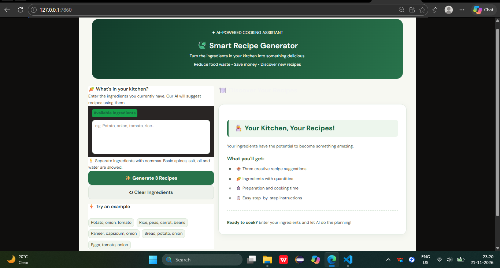
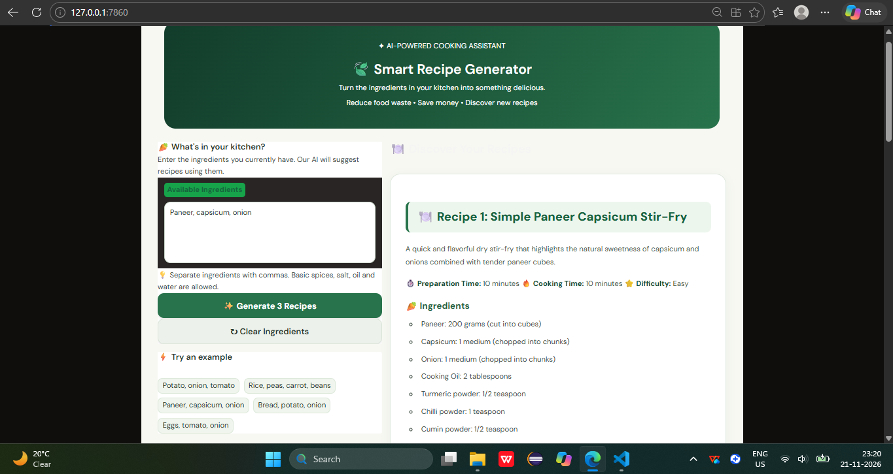

# 🍃 Smart Recipe Generator

**GenAI Mini Project — Problem Statement 54: Recipe Generator from Ingredients**  
**Roll Number:** 54

Smart Recipe Generator is an AI-powered cooking assistant that suggests three practical recipes from the ingredients available in a user's kitchen. It uses the Google Gemini API to generate recipe ideas, ingredient quantities, preparation and cooking times, difficulty levels, and step-by-step instructions.

The project aims to make everyday cooking easier, encourage the use of available ingredients, and help reduce food waste.

## Features

- Generate **exactly three recipe suggestions** from the ingredients entered by the user.
- Provide a short description, preparation time, cooking time, and difficulty level for each recipe.
- Include ingredient quantities and numbered cooking instructions.
- Follow ingredient constraints: use the ingredients provided by the user, with only the basic pantry additions specified in the prompt (salt, pepper, turmeric, chilli powder, cumin, coriander powder, cooking oil, and water).
- Offer quick example ingredient combinations.
- Clear the input and output using the Clear Ingredients button.
- Display results in a custom Gradio interface with a green-and-cream visual theme.

## Technologies Used

- **Python** — application logic
- **Google Gemini API** — AI recipe generation
- **Google Gen AI SDK (`google-genai`)** — communication with the Gemini model
- **Gradio** — web-based user interface
- **python-dotenv** — loading the API key from a local `.env` file
- **HTML and CSS** — interface layout and styling

**Model used:** `gemini-3.5-flash-lite`

## How It Works

1. The user enters the ingredients available in their kitchen, separated by commas.
2. The application sends the ingredient list and a structured prompt to the Gemini model.
3. The prompt asks Gemini to generate exactly three recipes and restricts it to the supplied ingredients and the permitted basic spices.
4. The generated response is displayed in the Gradio interface with recipe descriptions, timings, difficulty levels, ingredients, and instructions.

## Project Screenshots

**Figure 1. Application home screen**



**Figure 2. Generated recipe output**



## Setup and Installation

### Prerequisites

- Python 3.10 or later
- A Google Gemini API key
- Internet connection for Gemini API access

### 1. Clone the repository

```bash
git clone https://github.com/Tanvi1914/llm-ps54-54.git
cd llm-ps54-54
```

### 2. Create and activate a virtual environment

**Windows Command Prompt:**

```cmd
python -m venv venv
venv\Scripts\activate.bat
```

**Windows PowerShell:**

```powershell
python -m venv venv
.\venv\Scripts\Activate.ps1
```

If PowerShell blocks script activation because of the execution policy, use the Windows Command Prompt commands shown above instead.

### 3. Install dependencies

```bash
pip install -r requirements.txt
```

### 4. Configure the Gemini API key

Create a file named `.env` in the project root and add your own key:

```env
GEMINI_API_KEY=your_actual_gemini_api_key
```

The application loads this value from the local environment. Keep `.env` private; it is excluded from version control through `.gitignore`. The repository includes `.env.example` as a template.

### 5. Run the application

```bash
python app.py
```

Open the local Gradio URL shown in the terminal (normally `http://127.0.0.1:7860`) in your browser.

## Repository Structure

```text
llm-ps54-54/
├── app.py                  # Gemini recipe generation and Gradio interface
├── requirements.txt        # Python dependencies
├── .env.example            # Environment variable template (no real key)
├── .gitignore              # Excludes secrets and virtual environment
├── README.md               # Project documentation
└── screenshots/
    ├── 01-smart-recipe-generator-home.png
    └── 02-smart-recipe-generator-generated-recipes.png
```


## Problem Statement

**PS 54 — Recipe Generator from Ingredients:** Build an application that takes ingredients available to a user and uses a large language model to generate recipe suggestions. This project implements the task with Google Gemini and a Gradio-based interface.

## Future Improvements

- Add dietary preferences and cuisine selection.
- Include filters for preparation time and recipe difficulty.
- Add an option to scale ingredient quantities by serving size.
- Support additional languages for ingredient entry and recipe instructions.
- Improve validation to make generated recipes adhere even more closely to the available ingredients.

---

**Developed as a GenAI LLM Mini Project — PS 54.**
